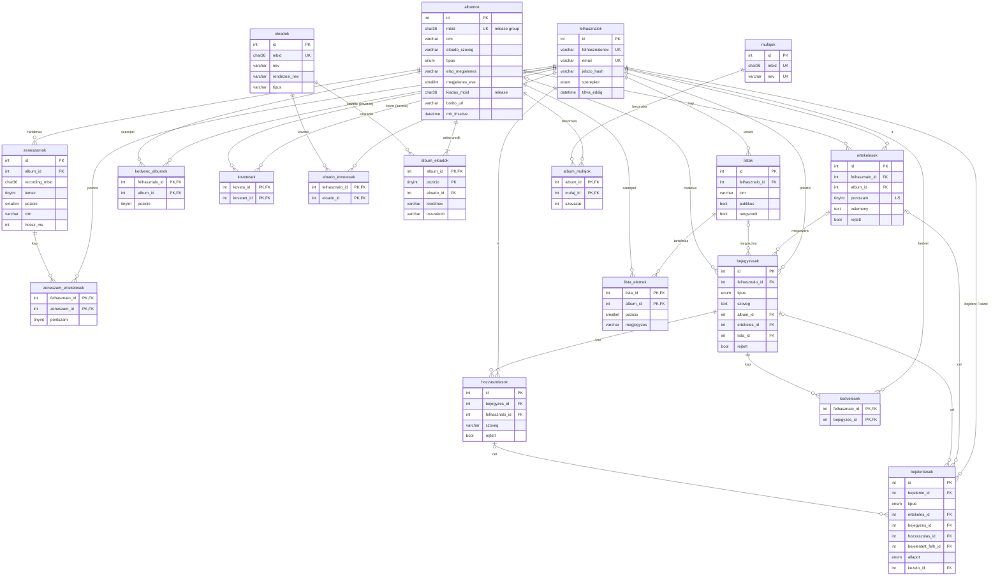

# TrackList – Adatbázisterv

MySQL 8.0+ (tesztelve: MySQL 8.4.13). A futtatható létrehozó script: `tracklist_schema.sql`.

A táblaneveket a meglévő előkészítő dokumentációhoz igazodva magyarul, ékezet nélkül adtuk meg (`felhasznalok`, `albumok`, `ertekelesek`, `bejegyzesek`, `listak`), kibővítve a drótvázakon látható funkciókkal (követés, kedvelés, hozzászólás, kedvenc albumok, zeneszámok).

## 1. Hogyan jön be a zenei adat (MusicBrainz)

A MusicBrainz-ben három különböző szint van, és fontos, hogy melyiket nevezzük "albumnak":

| MusicBrainz fogalom | Mit jelent | Nálunk |
|---|---|---|
| **Release group** | Az album mint mű. Egy release group-ba tartozik minden kiadása (sima, deluxe, remaster, vinyl…). Minden release pontosan egy release group-ba tartozik. | `albumok` – ezt értékelik a felhasználók |
| **Release** | Egy konkrét kiadás (dátum, ország, vonalkód, kiadó). | csak `albumok.kiadas_mbid`: innen vesszük a tracklistát |
| **Medium / Track / Recording** | Medium = egy lemez; Track = egy szám egy adott lemezen; Recording = maga a felvétel, ami több kiadáson is szerepelhet | `zeneszamok` (lemez + pozíció + recording MBID) |
| **Artist credit** | Az előadó(k) kiírása: több előadó, mindegyikhez kiírt név és összekötő ("joinphrase", pl. `" & "`, `" feat. "`) | `album_eloadok` + `albumok.eloado_szoveg` |
| **Genre** | A tagek közül a hivatalos műfajlistán szereplők, saját MBID-val | `mufajok`, `album_mufajok` |

Miért release group az album? Ha release-t értékelnének, a "Nevermind" értékelései szétszóródnának tucatnyi kiadás között. RYM és AOTY is így működik.

**Folyamat:** a keresés élőben megy a MusicBrainz API-ra. Amikor egy felhasználó megnyit vagy értékel egy albumot, a backend lekéri (`/ws/2/release-group/{mbid}?inc=artist-credits+genres+releases&fmt=json`, majd egy kiválasztott release-t `inc=recordings`-szal), és elmenti a helyi táblákba. Onnantól a saját adatbázisból szolgáljuk ki, az `mb_frissitve` alapján pedig időnként frissítjük.

Amire a backendnél figyelni kell (a MusicBrainz API dokumentációja szerint):
- legfeljebb **1 kérés másodpercenként** IP-címenként, különben 503-at kapunk;
- kötelező az értelmes **User-Agent**, pl. `TrackList/0.1 ( kapcsolat-email )`;
- az MBID 36 karakteres UUID. Ha két MB entitást összevonnak, a régi MBID átirányít az újra, így ha a válaszban más `id` jön vissza, frissíteni kell a tárolt `mbid`-t;
- a `first-release-date` lehet csak év (`"1991"`) vagy év-hónap is, ezért szövegként tároljuk, és mellé kiemeljük az évet (`megjelenes_eve`) szűréshez.

**Borító:** Cover Art Archive, `https://coverartarchive.org/release-group/{mbid}/front-500` (méretek: 250 / 500 / 1200). Ha nincs borító, 404-et ad, ezért `borito_url` csak akkor kap értéket, ha van kép.

## 2. ER-diagram

## 3. Táblák

Minden tábla InnoDB, `utf8mb4` (ékezetek, emojik, japán/koreai albumcímek miatt). Az MBID-k `CHAR(36) CHARACTER SET ascii` típusúak. Az idegen kulcsokhoz a MySQL automatikusan indexet tesz, ezeket külön nem soroljuk fel.

### Felhasználók

**felhasznalok** – regisztrált felhasználók, adminok is.
| Oszlop | Típus | Megjegyzés |
|---|---|---|
| id | INT UNSIGNED, PK, AI | |
| felhasznalonev | VARCHAR(30), UNIQUE | |
| email | VARCHAR(255), UNIQUE | |
| jelszo_hash | VARCHAR(255) | soha nem nyers jelszó |
| bemutatkozas | VARCHAR(500) NULL | profil |
| profilkep_url | VARCHAR(500) NULL | |
| szerepkor | ENUM('felhasznalo','moderator','admin') | a WPF admin csak admin/moderator szerepkörrel léphet be |
| tiltva_eddig | DATETIME NULL | NULL = nincs tiltva; ideiglenes és végleges (messzi dátum) tiltásra is jó |
| letrehozva, utolso_belepes | DATETIME | |

### MusicBrainz cache

**eloadok** – MB artist. `mbid` UNIQUE, `nev`, `rendezesi_nev` (sort-name), `tipus` (Person/Group…), `orszag` (ISO kód), `egyertelmusito` (disambiguation, pl. két azonos nevű zenekar megkülönböztetésére), `leiras` (saját, adminból szerkeszthető bemutatkozó), `mb_frissitve`. Index: `nev`.

**albumok** – MB release group. `mbid` UNIQUE, `cim`, `eloado_szoveg` (kész kiírás, hogy listázásnál ne kelljen joinolni), `tipus` (MB primary type: album/single/ep/broadcast/other), `elso_megjelenes` (VARCHAR(10), lásd fent), `megjelenes_eve`, `kiadas_mbid`, `borito_url`, `mb_frissitve`. Indexek: `megjelenes_eve`, FULLTEXT (`cim`, `eloado_szoveg`) a helyi kereséshez.

**album_eloadok** – az artist credit sorai. PK (`album_id`, `pozicio`). `eloado_id` FK, `kreditnev` (ahogy az albumon szerepel), `osszekoto` (joinphrase). Ebből jön az előadó adatlapon az "Albumok / EP-k" lista.

**zeneszamok** – a kiválasztott kiadás tracklistája. `album_id` FK, `recording_mbid`, `lemez`, `pozicio`, `cim`, `eloado_szoveg` (csak ha eltér, pl. feat.), `hossz_ms`. UNIQUE (`album_id`, `lemez`, `pozicio`). Index: `recording_mbid`, FULLTEXT `cim`.

**mufajok** – `nev` UNIQUE, `mbid` UNIQUE NULL. **album_mufajok** – kapcsolótábla, PK (`album_id`, `mufaj_id`), `szavazat` = MB "count", ebből választjuk ki a fő műfajt.

### Értékelés és listák

**ertekelesek** – pontszám + opcionális vélemény egy táblában. UNIQUE (`felhasznalo_id`, `album_id`): egy felhasználó egy albumot egyszer értékel, újraértékeléskor UPDATE. CHECK: `pontszam BETWEEN 1 AND 5`. `rejtett` a moderációhoz. Index: (`album_id`, `letrehozva`) az adatlap véleménylistájához.

**zeneszam_ertekelesek** – PK (`felhasznalo_id`, `zeneszam_id`), `pontszam` 1–5.

**listak** – `felhasznalo_id` FK, `cim`, `leiras`, `publikus`, `rangsorolt` (számozott toplista-e).

**lista_elemek** – PK (`lista_id`, `album_id`), `pozicio`, `megjegyzes`. Index (`lista_id`, `pozicio`) a rendezett listázáshoz.

**kedvenc_albumok** – a profil "Kedvenc albumok" blokkja. PK (`felhasznalo_id`, `album_id`), `pozicio`.

### Közösség

**kovetesek** – felhasználó követ felhasználót, PK (`koveto_id`, `kovetett_id`). **eloado_kovetesek** – felhasználó követ előadót.

**bejegyzesek** – a hírfolyam elemei. `tipus`: `poszt` (saját szöveg, opcionálisan csatolt albummal), `ertekeles` (egy értékelés megosztása, `ertekeles_id`), `lista` (új lista, `lista_id`). Indexek: `letrehozva`, (`felhasznalo_id`, `letrehozva`) a "követettek friss posztjai" lekérdezéshez.

**hozzaszolasok** – `bejegyzes_id`, `felhasznalo_id`, `szoveg`, `rejtett`. **kedvelesek** – PK (`felhasznalo_id`, `bejegyzes_id`), így egy bejegyzést egyszer lehet kedvelni.

### Moderáció (WPF admin)

**bejelentesek** – `tipus` szerint pontosan egy cél-oszlop van kitöltve (`ertekeles_id` / `bejegyzes_id` / `hozzaszolas_id` / `bejelentett_felh_id`). `indok`, `allapot` (nyitott/elfogadva/elutasitva), `kezelo_id` (admin), `kezelve`. Index (`allapot`, `letrehozva`) a "nyitott bejelentések" listához. Elfogadáskor az admin a cél `rejtett` mezőjét állítja TRUE-ra, vagy kitiltja a felhasználót.

### Nézet

**album_statisztika** – albumonként értékelésszám, átlag, véleményszám (a rejtett értékeléseket kihagyja). Ebből megy az adatlap "Átlagos értékelés: 4,2 / 5 · 124 felhasználó" sora és a "Népszerű albumok".

## 4. Fontosabb döntések röviden

1. **Belső INT kulcs + egyedi MBID.** A saját táblák kis, gyors INT kulcsokkal hivatkoznak egymásra, az MBID csak a MusicBrainz-zel való összekötésre kell. Így egy MBID-változás (entitások összevonása) egyetlen mező frissítése.
2. **Csak azt tároljuk el, amit valaki megnyitott vagy értékelt.** A teljes MusicBrainz-adatbázis több millió release; nem cél lemásolni.
3. **Egy kiadás tracklistája.** Egy release group-on belül a kiadások tracklistája eltérhet (bónusz számok). Egyet választunk (pl. a legkorábbi hivatalos, `status = official` kiadást), és eltároljuk a `kiadas_mbid`-t, hogy látsszon, honnan jön.
4. **Pontszám és vélemény egy táblában**, ahogy a korábbi tervben is szerepelt. Egyszerűbb lekérdezések, és a UNIQUE kulcs garantálja az "egy felhasználó, egy értékelés" szabályt. A drótvázak alapján 1–5 egész skála; ha RYM-szerű fél csillag kell, a `pontszam` lehet 1–10 (felcsillagokban), csak a CHECK változik.
5. **A hírfolyam egyetlen táblán megy (`bejegyzesek`).** Értékelés vagy lista megosztásakor a backend létrehoz egy bejegyzést, így a kedvelés és a hozzászólás mindig csak bejegyzésre mutat, valódi idegen kulccsal (nem kell "polimorf" cél_tipus+cél_id megoldás).
6. **Műfajok:** csak a MusicBrainz hivatalos műfajlistáját tároljuk (`inc=genres`), a szabad tageket (`inc=tags`) nem, mert azok zajosak.
7. **Szerepkör ENUM-ként** a felhasználó táblában, mert csak három fix szerepkör van; külön szerepkör tábla ennél túlzás lenne.

**Amit a backendnek kell ellenőriznie** (a MySQL CHECK nem használható olyan oszlopon, amelyhez ON DELETE CASCADE / SET NULL tartozik): önmaga követésének tiltása (`koveto_id <> kovetett_id`), és hogy a `bejelentesek` / `bejegyzesek` sorában a `tipus`-nak megfelelő cél-oszlop legyen kitöltve.

**Törlés:** a felhasználó törlése kaszkádolva törli az értékeléseit, listáit, posztjait. Éles működésben érdemesebb tiltani (`tiltva_eddig`), mint törölni.

**Szándékosan kihagytuk** (később bővíthető): kiadások (release) és kiadók teljes tárolása, release group másodlagos típusok (live, compilation, soundtrack…), értesítések, admin műveleti napló.

## 5. Ellenőrzés

A scriptet MySQL 8.4.13-on lefuttattuk: minden tábla és a nézet létrejött. Mintaadatokkal teszteltük, hogy a CHECK elutasítja a 6-os pontszámot, a UNIQUE kulcs a második értékelést ugyanarra az albumra, és hogy egy felhasználó törlése kaszkádolva törli a hozzá tartozó értékeléseket, bejegyzéseket, hozzászólásokat és bejelentéseket.

## Források

- MusicBrainz – Release Group: https://musicbrainz.org/doc/Release_Group
- MusicBrainz – Release: https://musicbrainz.org/doc/Release
- MusicBrainz – Recording / Track: https://musicbrainz.org/doc/Recording, https://musicbrainz.org/doc/Track
- MusicBrainz API (rate limit, User-Agent, inc paraméterek, típusok): https://musicbrainz.org/doc/MusicBrainz_API
- MusicBrainz Identifier: https://musicbrainz.org/doc/MusicBrainz_Identifier
- Cover Art Archive API: https://musicbrainz.org/doc/Cover_Art_Archive/API
- MySQL 8.4 – CHECK constraints: https://dev.mysql.com/doc/refman/8.4/en/create-table-check-constraints.html
